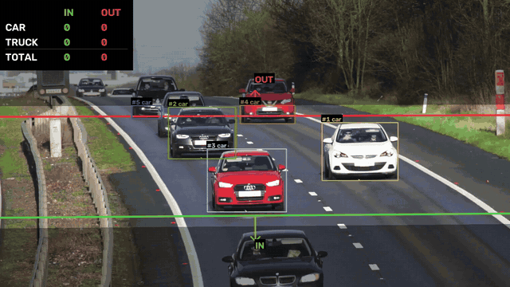
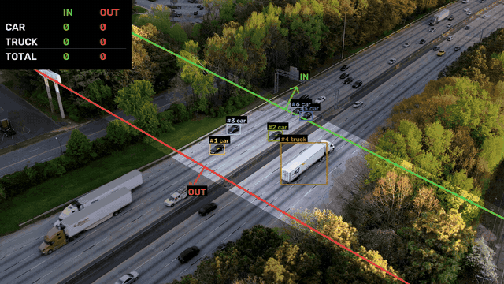
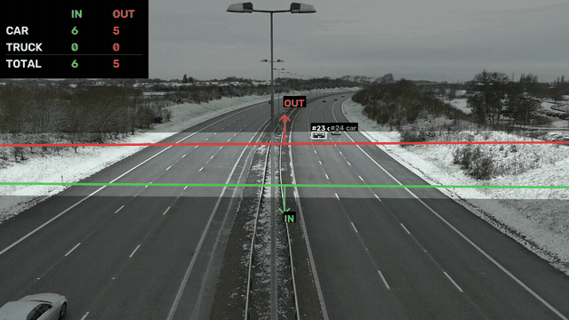
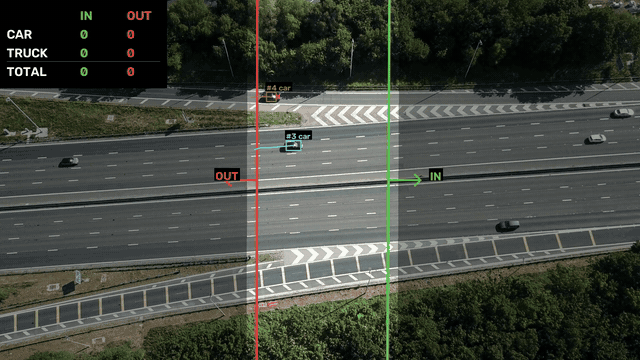
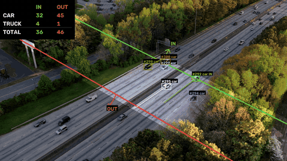
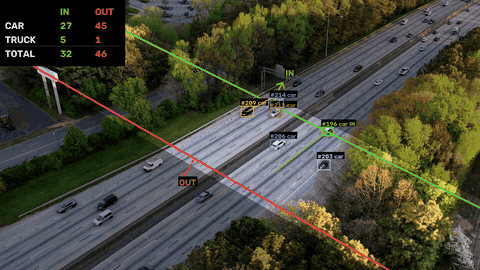

# Car Count & Track

Count the **cars and trucks** that leave a zone of the road, and in which **direction** (IN or OUT), from traffic video.

Vehicles are detected with **YOLO11** and followed with **ByteTrack**. A vehicle is counted when it leaves a **counting zone** that you draw on the first frame with two lines. The program is evaluated in two experiments: a **front view** and an **aerial (drone) view**. For the aerial view, the detector is **fine-tuned**.

| Front view | Aerial view |
|:---:|:---:|
|  |  |
|  |  |

---

## Possible uses

| Area | Application |
|---|---|
| Traffic engineering | Volume and peak-hour studies per direction, from the timestamped events |
| Road planning | Before/after counts for a new lane, roundabout or traffic-light timing |
| Heavy-vehicle monitoring | Share of trucks on a road or freight corridor |
| Temporary surveys | Quick counts from one drone flight or a phone on a tripod, with no infrastructure |
| Parking and access control | IN/OUT counts at car parks, logistics yards or ports, and from them the occupancy |
| Retail and services | Arrivals per hour at drive-throughs, fuel stations or shopping centres |
| Environmental studies | Traffic volumes split by vehicle type, for emission or noise estimates |
| Data annotation and teaching | Pre-labelling vehicle datasets; a small, complete detection + tracking + fine-tuning example |

Before relying on the numbers, validate against a manual count for each new camera. Respect privacy regulations, such as the GDPR, when you record or publish footage.

---

## How it works

### The counting zone

On the first frame you click **5 points**: **line 1** (2), **line 2** (2) and an **IN point** (1) outside the zone. The area between the lines is the **counting zone**. The line on the IN point's side becomes the **IN line** (green), and the other one the **OUT line** (red).

```
   ─────────────────────────────────  OUT line (red)
         ↑ leaves here → OUT
   ┌─────────────────────────────┐
   │        COUNTING ZONE        │    vehicles are detected and tracked only here
   └─────────────────────────────┘
         ↓ leaves here → IN
   ─────────────────────────────────  IN line (green)
             ● IN point
```

- A vehicle is counted **once**, when it **leaves** the zone: through the IN line it counts **IN**, through the OUT line it counts **OUT**. Entering the zone is not counted.
- **Only the zone is analysed.** The outside is blacked out before detection, which avoids false positives there, and the frame is cropped to the zone, which makes it faster. A small margin lets the tracker see each vehicle cross the line.
- **Lines are extended to the edges of the frame**, so a vehicle leaving the zone anywhere in the image is counted.
- The zone is saved per video and pre-loaded on the next run.

### Cars and trucks

Detector classes are mapped to two categories: `car → car`, and `truck`/`bus → truck`, since COCO models often call lorries *bus*. Each track's category is the **majority vote** over its frames, so a truck detected as a car for a few frames still counts as a truck. Counts are reported as **CAR / TRUCK × IN / OUT**.

### Pipeline


It runs at about **9–19 frames/s** on an Apple M-series GPU, depending on the size of the zone.

---

## Experiment 1: front view

A fixed camera looking along the road, in two scenes (GIFs above): **telephoto** oncoming traffic, where distant vehicles are compressed together, and a motorway in **snow** with traffic in both directions and low contrast.

The COCO-pretrained `yolo11s` **works out of the box**. Inside the zone, vehicles are large and seen from the front, back or side, the viewpoints COCO is trained on. Tracks are stable, and each vehicle is counted once and in the right direction. Over one minute per scene it counted **31 vehicles** in the telephoto scene and **41** in the snow scene (18 IN, 23 OUT).

**Tip:** draw the zone in the near half of the frame, where vehicles are clearly separated.

---

## Experiment 2: aerial view

A static drone looking down at the road, in two scenes (GIFs above): a multi-lane **highway** with lorries, and a **motorway** seen from higher up with small, often dark cars.

From above, the COCO model struggles. Cars are only **20–40 px** long, seen from the roof (a viewpoint COCO rarely has), and often dark on dark asphalt. So the detector was improved in **three stages**.

### Stage 1: base model

`yolo11s` pretrained on COCO, with no aerial training. It detects larger cars and lorries, but **misses many small and dark cars**, sometimes labels a lorry trailer or a road sign as *bus*, and loses tracks when detections drop.

### Stage 2: fine-tuning for small cars

The model is fine-tuned on top-down footage from a **separate** drone video of an urban junction, not one of the test scenes:

- Frames are cut into **640 px tiles** at the same scale used at inference, so cars are as small in training as in use.
- The tiles are **auto-labelled by a large teacher model** (`yolo11x`, with 2× upscaling and test-time augmentation). The small model learns to find, in one fast pass, the small cars that the teacher only finds with those tricks.
- Training uses **1,032 tiles** with ~35,000 cars, with the backbone frozen; it took 39 min on an M1 Pro.

**Gain:** in the motorway scene it tracks **2.7× more cars per frame** and counts **27 vehicles instead of 11**, now in both directions, at the same speed. **New weakness:** the training video has almost no articulated lorries, so it sometimes **misses long lorries** that the base model caught.

### Stage 3: fine-tuning for trucks

The stage 2 model is fine-tuned again with **hand-labelled trucks and buses** from [VisDrone](https://github.com/VisDrone/VisDrone-Dataset), a drone dataset:

- Only tiles containing trucks are used: a random sample of 2,500, mixed with the stage 2 data repeated twice so the small-car knowledge is kept.
- The result has **11,933 trucks**, 4.8× more than stage 2, with real human labels instead of teacher labels.
- Training starts from the stage 2 weights (15 epochs, 55 min on an M1 Pro).

**Gain:** on held-out drone images with human labels, truck detection almost **triples** (mAP50 0.20 → 0.57, recall 0.27 → 0.50), while small cars are kept exactly (mAP50 0.986 on the stage 2 validation set, unchanged). In the highway scene it counts **14 trucks instead of 11**, detects the articulated lorries again, and no longer boxes the road sign. In the motorway scene it tracks even more small cars (3.2 per frame) with fewer broken tracks.

### Comparison

The same 20 s clip of the highway scene, with the same zone and settings, processed with each model:

| 1. Base model | 2. + small cars | 3. + trucks |
|:---:|:---:|:---:|
|  |  |  |

| | Small cars (motorway) | Trucks (highway) | Truck mAP50* | Speed |
|---|---|---|---|---|
| 1. Base model | ✗ 1.0 tracked per frame, 11 counted | ✓ 11 counted, sign mistaken for a bus | – | ~17 fps |
| 2. + small cars | ✓ 2.7 per frame, 27 counted | ✗ some long lorries missed, 11 counted | 0.20 | same |
| 3. + trucks | ✓ **3.2** per frame, 27 counted | ✓ **14 counted**, lorries recovered | **0.57** | same |

\* On held-out drone images with human labels (VisDrone + stage 2 data).

Each fine-tuning fixes the previous stage's weak spot: **stage 2** finds the small cars the base model misses, and **stage 3** recovers the trucks stage 2 lost, without giving back the small cars. All three stages share the same architecture, so they run at the same speed. There is no hand-counted ground truth for these scenes, so the comparison relies on vehicles tracked per frame, the counts, validation metrics and a frame-by-frame visual check. Stage 3 is the default aerial model (`weights/aerial-vehicle.pt`).

---

## Usage

### Installation

Requires Python 3.10+.

```bash
python -m venv .venv
source .venv/bin/activate
pip install -r requirements.txt     # requirements-dev.txt also installs pytest
```

Weights live in `weights/` and are not in the repository. The front view uses `yolo11s.pt`, which is downloaded automatically. The aerial view uses the fine-tuned `weights/aerial-vehicle.pt`: [train it](#fine-tuning), or run with `-w yolo11s.pt`.

### Run

The presets in `configs/` (`front-view`, `aerial-view`) hold the model, classes, thresholds and tracker settings. The first run creates a local `experiments/<experiment>/` folder from the preset. Put your videos in its `videos/` subfolder and run:

```bash
python -m carcounter -e front-view                   # every video of the experiment
python -m carcounter -e aerial-view -v my_video.mp4  # a single video
```

1. The first frame opens. Click line 1, line 2 and the IN point, then press `Enter` (`u` undo · `r` redraw · `q` skip).
2. Detection, tracking and counting run with a live preview (`q` stops early and saves what was processed).
3. Results go to `results/<experiment>/`: `<video>_annotated.mp4`, `<video>_events.csv` (one row per counted vehicle) and `<video>_summary.json` (totals per category).

Options: `-w <weights>` to use other weights · `--reuse-lines` to skip the zone window · `--frame-time S` to draw the zone at second S · `--no-preview` · `--max-frames N`.

### Fine-tuning

```bash
# Stage 2: small cars (auto-labelled tiles from a drone video)
python finetune/prepare_dataset.py --video data/finetune/aerial-view/<drone_video>.mp4 --out datasets/aerial-vehicles
python finetune/train.py --data datasets/aerial-vehicles/data.yaml --out weights/aerial-vehicle-v1.pt

# Stage 3: trucks (downloads VisDrone, ~1.5 GB)
python finetune/add_visdrone.py --base datasets/aerial-vehicles --out datasets/aerial-vehicles-trucks
python finetune/train.py --data datasets/aerial-vehicles-trucks/data.yaml --model weights/aerial-vehicle-v1.pt \
    --name aerial-vehicle-trucks --epochs 15 --patience 5 --out weights/aerial-vehicle.pt

# Compare models on your aerial videos (same zones and settings)
python finetune/compare.py --models yolo11s.pt weights/aerial-vehicle-v1.pt weights/aerial-vehicle.pt
```

### Tests

```bash
pip install -r requirements-dev.txt && pytest
```

---

## Project structure

```
car-count-track/
├── carcounter/      # library + CLI: geometry, counter, zone UI, drawing, pipeline, paths
├── configs/         # presets: front-view.yaml, aerial-view.yaml
├── finetune/        # prepare_dataset.py, add_visdrone.py, train.py, compare.py
├── tests/           # unit tests (pytest)
├── results/         # outputs; only the README GIFs are committed
│
│   # local only (git-ignored)
├── experiments/     # your videos, zones and config copies
├── weights/         # official and fine-tuned models
├── data/            # fine-tuning videos
├── datasets/        # generated training datasets
└── runs/            # training runs and logs
```

## Limitations

- Static camera only. A moving camera would need stabilisation first.
- The lines are straight. On curved roads, or with several roads in view, draw the zone so that only the traffic you want to count crosses it.
- A track that appears and leaves within a few frames can add a false count.
- The aerial model can still box small red roadside objects (such as roadwork barriers) as trucks. They are only counted if they leave the zone, which static objects don't.

## License

[AGPL-3.0](LICENSE), as required by [Ultralytics YOLO](https://github.com/ultralytics/ultralytics). The demo footage in the GIFs is free stock video from [Pixabay](https://pixabay.com/) (Pixabay Content License) and is not included. [VisDrone](https://github.com/VisDrone/VisDrone-Dataset) is for academic/research use only; the stage 3 weights are trained on it and inherit that restriction.
